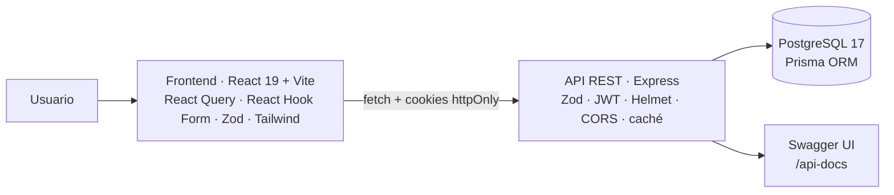

# ✅ Avanxa

**Aplicación full-stack para crear hábitos, registrarlos cada día y ver tu progreso con rachas, estadísticas y un panel de administración.** Monorepo en TypeScript: React 19 en el frontend y una API REST con Express, Prisma y PostgreSQL.

[](https://github.com/jmnzcn/avanxa/actions/workflows/ci.yml)


[English summary](#-english-summary) · [Funcionalidades](#-funcionalidades) · [Arquitectura](#-arquitectura) · [Caso de estudio](#-caso-de-estudio-de-prototipo-a-app-integrada) · [Calidad](#-calidad-tests-y-ci) · [Cómo correrlo](#-cómo-correrlo)


---

## ✨ Funcionalidades

- **Hábitos:** crear, editar, desactivar y eliminar hábitos diarios, semanales o mensuales, con búsqueda, filtros y paginación.
- **Registro diario:** marcar un hábito como completado, con notas opcionales; el backend evita duplicados el mismo día.
- **Progreso:** racha actual y más larga (contada en días, semanas o meses según la frecuencia del hábito), tasa de cumplimiento, progreso por semana y por mes, y logros desbloqueables.
- **Panel principal:** hábitos activos, mejor racha, completados hoy, porcentaje de la semana y del mes, actividad reciente y cumplimiento por hábito en los últimos 30 días.
- **Administración:** estado del sistema (base de datos, tiempo activo, conexiones), métricas globales, gestión de usuarios (bloquear, restablecer contraseña, eliminar) y registro de auditoría de cada acción de admin.
- **API documentada** con Swagger en `/api-docs`.

<table>
<tr>
<td width="50%"></td>
<td width="50%"></td>
</tr>
<tr>
<td align="center"><sub>Mis hábitos: búsqueda, filtros y acciones</sub></td>
<td align="center"><sub>Progreso de un hábito: completado hoy y avance semanal</sub></td>
</tr>
<tr>
<td width="50%"></td>
<td width="50%"></td>
</tr>
<tr>
<td align="center"><sub>Panel de admin: salud del sistema y métricas</sub></td>
<td align="center"><sub>Gestión de usuarios</sub></td>
</tr>
</table>

---

## 🧩 Arquitectura



| Capa | Detalles |
|---|---|
| **Autenticación** | JWT de acceso (15 min) y de refresco (7 días) en cookies `httpOnly` con `sameSite=strict`; contraseñas con bcrypt; roles `USER` y `ADMIN`; usuarios bloqueables |
| **Validación** | Zod en el backend (cuerpo y parámetros de cada endpoint) y en los formularios del frontend |
| **Datos** | Prisma con PostgreSQL: usuarios, hábitos, progreso y auditoría, con índices en las columnas de consulta frecuente y restricción de un registro por hábito por día |
| **API** | 40+ endpoints REST con respuestas uniformes `{ success, data }`, borrado lógico de hábitos, caché en memoria en lecturas frecuentes y documentación OpenAPI |
| **Frontend** | React Query para caché e invalidación, rutas protegidas, carga diferida por página y una capa de servicios que adapta el contrato de la API a los tipos de la UI |

---

## 🔧 Caso de estudio: de prototipo a app integrada

Al levantar la app para documentarla, el frontend y el backend **no estaban conectados de verdad**: el usuario aparecía como *"undefined undefined"*, la lista de hábitos salía vacía aunque la API devolvía datos, el panel mostraba cifras fijas y el admin no cargaba. El backend estaba bien; el frontend se había escrito contra otro contrato.

**Qué encontré y cómo lo resolví:**

1. **Contrato de respuestas distinto.** El backend envuelve todo en `{ success, data }` y el frontend leía la respuesta directa. Unifiqué tres clientes HTTP duplicados en uno ([`frontend/src/lib/api.ts`](frontend/src/lib/api.ts)) que desempaqueta `data`.
2. **Formas y rutas que no coincidían.** El login devuelve `{ user, accessToken, refreshToken }`, no `{ user, tokens }`; la frecuencia es `"daily"`, no `"DAILY"`; la paginación viene en `pagination`; y algunas rutas de progreso no existían. En lugar de tocar todos los componentes, cada servicio ahora **adapta** el contrato de la API a los tipos de la UI.
3. **Panel con datos inventados.** Las 6 métricas, la actividad reciente, los "próximos objetivos" y los "logros" eran valores fijos. Ahora salen de 5 endpoints reales ([`dashboardService.ts`](frontend/src/services/dashboardService.ts)), incluido el cumplimiento por hábito de los últimos 30 días.
4. **Bugs de lógica:**
   - "Completado hoy" se calculaba como "hay registros esta semana".
   - La tasa de cumplimiento podía superar el 100 %.
   - El panel de admin enviaba fechas `YYYY-MM-DD` cuando el backend exige ISO completo.
   - Faltaban el tiempo activo y las conexiones del sistema; los agregué al endpoint de salud con datos reales en vez de inventarlos.
5. **Un hueco de seguridad:** un usuario bloqueado por el admin seguía usando la API hasta que vencía su token, porque el middleware que revisaba el bloqueo existía pero ninguna ruta lo usaba. Ahora la verificación ocurre en cada request autenticado; lo detectó un test.
6. **Rachas mal calculadas:** había dos copias del mismo algoritmo, que siempre contaban días (en un hábito semanal la racha nunca pasaba de 1) y comparaban fechas en milisegundos, lo que fallaba en los cambios de horario de verano. Lo reemplacé por una función pura que cuenta por día, semana o mes ([`backend/src/lib/streak.ts`](backend/src/lib/streak.ts)).
7. **Detalles de interfaz:** el menú lateral tapaba el contenido en pantallas angostas, había dos enlaces del menú sin página detrás, un título duplicado y un botón con texto ilegible.
8. **Datos de demo realistas:** el seed ahora crea 5 hábitos con 6 semanas de historial determinista, para que rachas y gráficos tengan sentido.

Verificado en el navegador (login, panel, hábitos, registro de un hábito, progreso y admin) y cubierto por los tests de la sección siguiente.

---

## 🧪 Calidad: tests y CI

| | |
|---|---|
| **Backend: 42 tests** | Vitest + Supertest contra una base PostgreSQL de prueba que se recrea en cada corrida: registro y login, cookies `httpOnly`, usuarios bloqueados, CRUD de hábitos, aislamiento entre usuarios, registro diario sin duplicados, rachas diarias y semanales, permisos de admin, auditoría y salud del sistema |
| **Frontend: 18 tests** | Vitest sobre el cliente HTTP y los adaptadores de cada servicio: traducción del contrato de la API, agregación del panel y manejo de fechas |
| **Tipos** | 0 errores de TypeScript en backend y frontend (había 61 en el frontend: React Query v5 y un conflicto de versiones de Zod en el monorepo) |
| **CI** | GitHub Actions en cada push y pull request: levanta PostgreSQL, verifica tipos, corre los tests y hace el build |

```bash
npm run typecheck   # backend + frontend
npm test            # 60 tests (el backend necesita el PostgreSQL de docker compose)
```

---

## 🚀 Cómo correrlo

Requisitos: Node.js 20+ y Docker.

```bash
git clone https://github.com/jmnzcn/avanxa.git
cd avanxa
npm install

# Base de datos
docker compose up -d db
cp backend/env.example backend/.env
npm run db:generate
npm run db:push
npm run db:seed

# Backend (:3001) y frontend (:3000)
npm run dev
```

Abre http://localhost:3000. La documentación de la API está en http://localhost:3001/api-docs.

**Cuentas de demo** (las crea `npm run db:seed`, solo para desarrollo local):

| Rol | Email | Contraseña |
|---|---|---|
| Usuario | `user@avanxa.com` | `user123` |
| Admin | `admin@avanxa.com` | `admin123` |

<details>
<summary>Otros comandos</summary>

```bash
npm run backend:dev     # solo backend
npm run frontend:dev    # solo frontend
npm run build           # build de producción de ambos paquetes
npm run db:migrate      # migraciones de Prisma
npm run db:studio       # Prisma Studio
```
</details>

<details>
<summary>Estructura del repositorio</summary>

```text
backend/
  prisma/schema.prisma   modelos: User, Habit, HabitProgress, AuditLog
  src/routes/            auth, habits, progress, users, admin, upload
  src/services/          lógica de negocio y validación (Zod)
  src/middleware/        auth (JWT), caché, logging, uploads
  src/prisma/seed.ts     datos de demo
frontend/
  src/services/          clientes de la API y adaptadores de contrato
  src/pages/             hábitos, progreso, admin, login
  src/components/        dashboard, hábitos, progreso, admin, layout, ui
docs/screenshots/        capturas del README
```
</details>

---

## 📌 Estado y próximos pasos

- **Despliegue público:** el siguiente paso es publicar una demo (por ejemplo, frontend en Vercel y API + PostgreSQL en Render o Railway).
- **Tests de interfaz:** los componentes de React no tienen tests propios todavía; un siguiente paso natural son tests end-to-end con Playwright sobre los flujos principales.

---

## 🇺🇸 English summary

**Avanxa** is a full-stack habit tracker: a TypeScript monorepo with a **React 19 + Vite** frontend and an **Express + Prisma + PostgreSQL** REST API (JWT auth in httpOnly cookies, Zod validation, Swagger docs, role-based admin panel with audit logging).

When I brought the app up to document it, the frontend wasn't really wired to the backend: user data showed as *"undefined"*, the habit list was empty, and the dashboard showed hard-coded numbers. I traced it to a **contract mismatch** (response envelope, field names, enum casing, pagination, missing routes). I fixed it with a single HTTP client plus **adapter layers** in each service, connected the dashboard to 5 real endpoints, and fixed several logic bugs: "completed today", completion rates over 100 %, and date formats the admin API rejected. I also wrote a realistic demo seed. Everything was verified end to end in the browser.

I then added **60 automated tests** (42 backend API tests with Vitest + Supertest against a real PostgreSQL database, 18 frontend tests for the service adapters), took the frontend from **61 TypeScript errors to 0**, and set up **GitHub Actions CI**. The tests surfaced a real security gap: blocked users kept API access until their token expired. I also rewrote streak calculation to count days, weeks or months depending on the habit's frequency, and to stay correct across DST changes.

---

**Ney Fred Jiménez Campos** · [LinkedIn](https://www.linkedin.com/in/neyfred/) · [GitHub](https://github.com/jmnzcn) · neyfred@gmail.com
